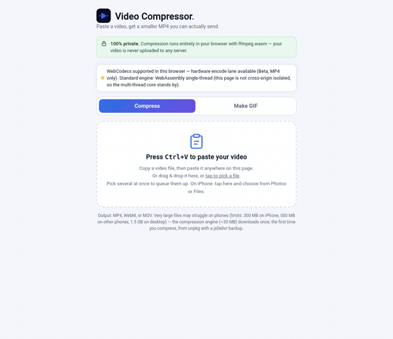

# Free Video Compressor

**Current version: v7**

Paste a video, get a smaller MP4. No uploads, no accounts, no tracking — compression runs 100% in your browser.

**Live demo:** https://video-compressor-e82.pages.dev

## How to use

Five tabs, all client-side, nothing uploaded:

**Compress tab** (video to a target size, timeline trimmer, formats, batch queue) and **Make GIF tab** as before, plus:

**Files tab** — zip anything, losslessly. Pick files, get one `.zip` back; unzipping restores the originals byte-for-byte. Can also extract a `.zip` you already have. Honest note shown in the tab: already-compressed files (videos, photos, MP3s) barely shrink under ZIP — it mainly bundles them into one download.

**Images tab** — shrink photos to an exact KB target (presets: 20 KB signature, 50 KB portal photo, 100 KB, 200 KB, 240 KB US visa, or any custom KB). Lowers JPEG quality first, then dimensions, until it fits; reports the smallest achievable size when a target can't be reached. Output is JPEG; transparency is flattened to white.

**PDF tab** — shrink a PDF to an exact KB target (presets 200 KB / 500 KB / 1 MB). Pages are rendered with pdf.js and rebuilt with pdf-lib at progressively lower DPI/quality until the file fits. Trade-off, stated in the tab: rebuilt pages are images, so text is no longer selectable or copyable. Best for scanned PDFs and forms. Password-protected PDFs are not supported.

**Compress tab (video):**
1. **Ctrl+V** a video anywhere on the page (or drag & drop it, or tap to pick a file on mobile). Pick several files at once and they queue up and compress one after another with the same settings — each file gets a live status pill (waiting / encoding % / done) and a **Download all as ZIP** button appears when two or more finish.
2. Choose how it shrinks:
   - **Target size** — a labeled platform preset matrix (Micro-Clip ~8 MB, WhatsApp ~16 MB, Discord · Email ~25 MB, Large ~50 MB, Reddit ~100 MB, X / Twitter ~512 MB), an exact-size box (type any MB value), or the custom bitrate slider. The bitrate is computed from the clip's trimmed duration in real time — and after encoding, the app **measures the real output**: if it landed outside ±5% of the target, it recomputes the bitrate from the measured size and encodes once more. (Verified ±5% across an 8/16/25 MB × MP4/MOV/WebM test matrix.) If a target is mathematically unreachable for the clip's length — or the clip's content simply can't absorb that many bits — the page says so honestly instead of pretending.
   - **Quality (CRF)** — one slider from near-original to tiny; the encoder picks the bitrate.
3. **Trim on the timeline**: a filmstrip of your actual clip with draggable in/out handles, a tap-to-scrub playhead, and a live "keeping X of Y" readout. The target bitrate recomputes while you drag. Precise numeric start/end fields stay in sync both ways.
4. Optionally cap the resolution (720p / 1080p / original), pick an output format (**MP4 / WebM / MOV**), or strip the audio with the one-tap toggle — it shows the real percentage the audio track costs at your current settings.
5. Hit **Compress**, watch the progress bar. Keep the tab open while it works — on phones it also asks the system to keep your screen on.
6. **Compare before you download**: the original and the compressed result play side by side under a draggable divider, scrubbing in sync, with a live spectrum/waveform visualizer and an audio badge showing the real stream info (e.g. "AAC · 48 kHz · stereo → AAC 96 kbps").

A **capability badge** at the top tells you honestly which engine will do the work in your browser. On browsers with WebCodecs, an opt-in **Beta hardware lane** (MP4 in → MP4 out) encodes with the GPU where available and falls back to the standard engine automatically if anything fails — your audio is never silently dropped.

**Make GIF tab:**
1. Paste/drop/pick a video (the selected file is shared between tabs).
2. Set **start time**, **duration** (1–10 s), **width** (320/480/640), and **FPS** (10/12/15). An on-screen estimate shows the likely GIF size range (calibrated against measured output: ~0.08 bytes/px/frame for simple footage up to ~0.65 for very noisy video), with a warning when a combo is headed past ~10 MB.
3. Hit **Make GIF** — it encodes with the high-quality two-pass palette method (palettegen/paletteuse).
4. Preview the animated GIF, check its size, then **Download** the .gif. Short GIFs stay small enough to upload straight to Reddit, where they play animated inline.

## Privacy

This is the whole point of the project:

- **100% client-side.** Your video never leaves your device. There is no server, no upload endpoint, no account.
- **Zero trackers, zero analytics, zero telemetry.** The only network requests the page makes (besides loading itself) are fetching the ffmpeg.wasm engine and, when used, the small helper libraries (MP4Box, mp4-muxer, fflate) from public CDNs on first use.
- Nothing you compress is visible to anyone but you — not even the site owner.

## Browser requirements

Any modern browser: Chrome, Edge, Firefox, Safari (desktop and mobile).

The live site sends `Cross-Origin-Opener-Policy` / `Cross-Origin-Embedder-Policy` headers. When a browser grants cross-origin isolation, the app first tries the **multi-threaded** ffmpeg.wasm core; everywhere else — and if the multi-thread core fails for any reason, including mid-encode — it automatically falls back to the **single-threaded** core, the exact engine previous versions shipped, and retries your file once on it. No setting to flip, and the capability badge at the top always names the engine actually in use. (Known quirk, stated plainly: in current Firefox the multi-thread core loads but crashes on its first encode, so Firefox users land on the single-thread engine after that one automatic retry.) The Beta hardware lane uses WebCodecs where the browser offers it (Chromium primarily) and is always opt-in.

## How it works

The page loads ffmpeg.wasm 0.12.10 as ES modules from unpkg (falling back to jsDelivr, with a per-source timeout) and spawns its worker from a same-origin blob (bundling the four ESM worker files) via the `classWorkerURL` option, using the ESM core build. Your file is written to in-memory storage and re-encoded: **H.264 (veryfast preset) + AAC 96 kbps** for MP4/MOV, or **VP8 + Vorbis 96 kbps** for WebM. In target-size mode the bitrate is computed from your chosen size and the clip's (trimmed) duration, then corrected once against the measured output if needed; WebM size mode encodes **two-pass**, because the WebAssembly VP8 encoder's single-pass rate control can't hold a size target (measured +71% over on noisy footage, where two-pass lands within ~2%). In CRF mode the encoder picks the bitrate. Phone clips are converted to constant frame rate so audio stays in sync, and MP4/MOV output gets the faststart flag so it starts playing before it finishes downloading.

Temporary files inside the engine's in-memory filesystem are deleted after every encode — on failure too — and if the engine ever crashes at the WebAssembly level, the app terminates it and reloads a fresh one rather than leaving a dead engine behind. (One upstream bug shaped a choice here: the stock core's Opus audio path crashes on 48 kHz stereo AAC inputs — the audio most phones record — so WebM audio uses Vorbis, which encodes the same inputs reliably. Same 96 kbps target, spec-valid WebM.)

The Beta hardware lane demuxes MP4 with MP4Box.js, decodes/re-encodes video (and audio: AAC where offered, otherwise Opus) with WebCodecs, and muxes with mp4-muxer using explicit decode timestamps. Any failure at any step aborts the lane and the standard engine takes over.

## Size limits

Browser memory is the ceiling: 1.5 GB max file size on desktop, 500 MB on phones, 300 MB on iPhones.

## License

MIT

---

## Velazquez Lab

More free tools from Cesar Velazquez: [Velazquez Lab](https://velazquez-lab.pages.dev)

- GitHub: https://github.com/crtGhoul
- Codeberg: https://codeberg.org/crtGhoul
- YouTube: https://www.youtube.com/@VelazquezLabs
- Reddit: https://www.reddit.com/user/Manteqaada/

> Have you used Muse? If not, you can earn a free 1B tokens when you sign up with my code: 0NS5DG — redeem it in Muse Settings > Redeem token within 48 hours of joining. Joining alone does not count.
